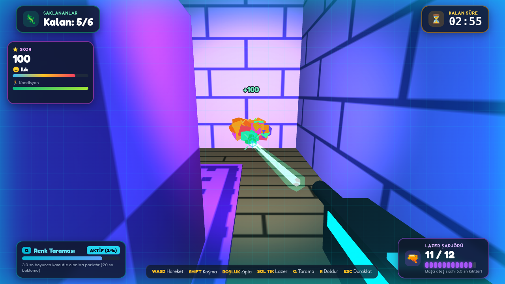
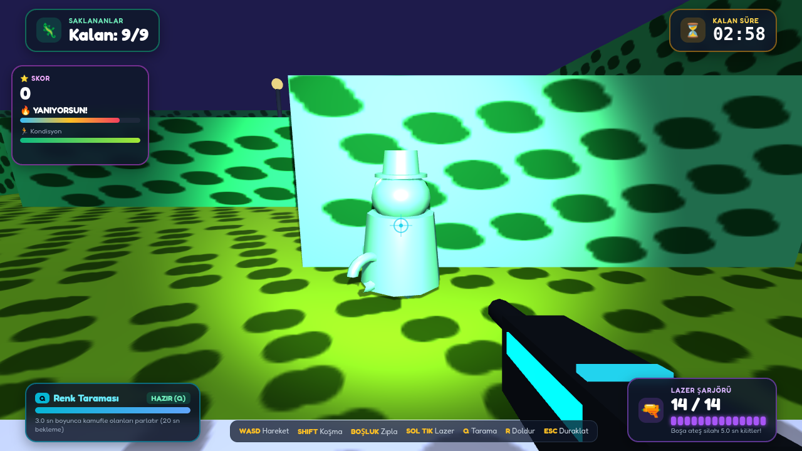
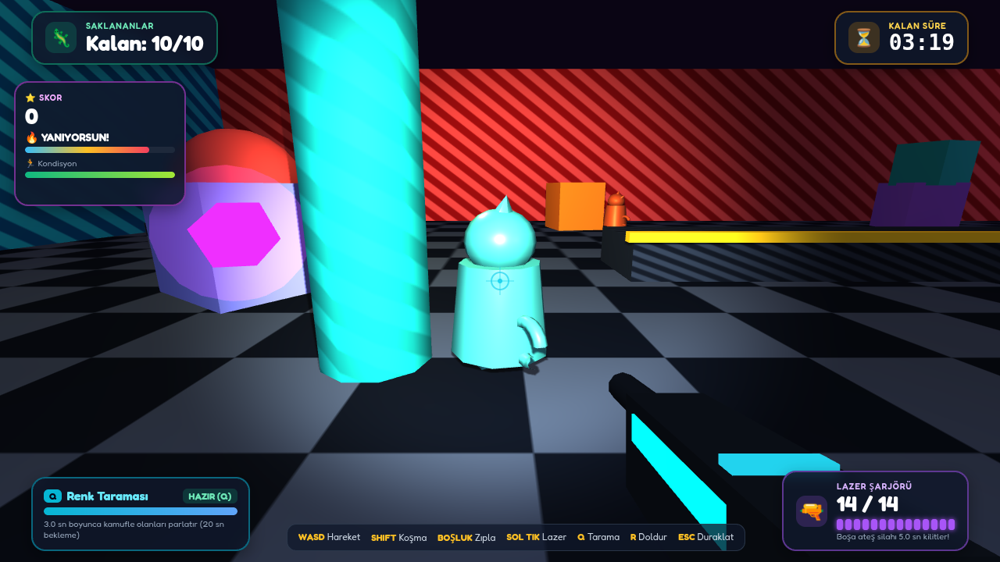
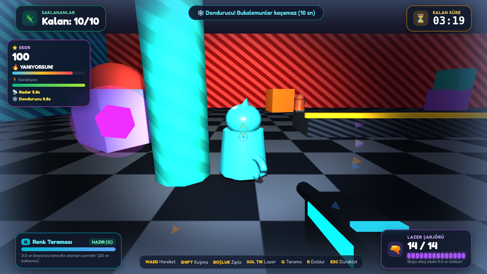
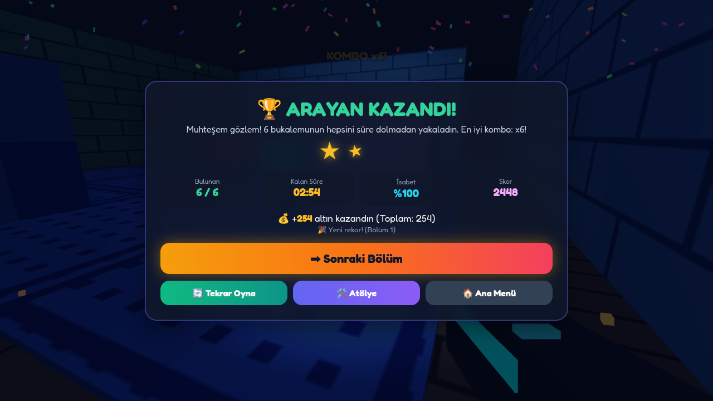
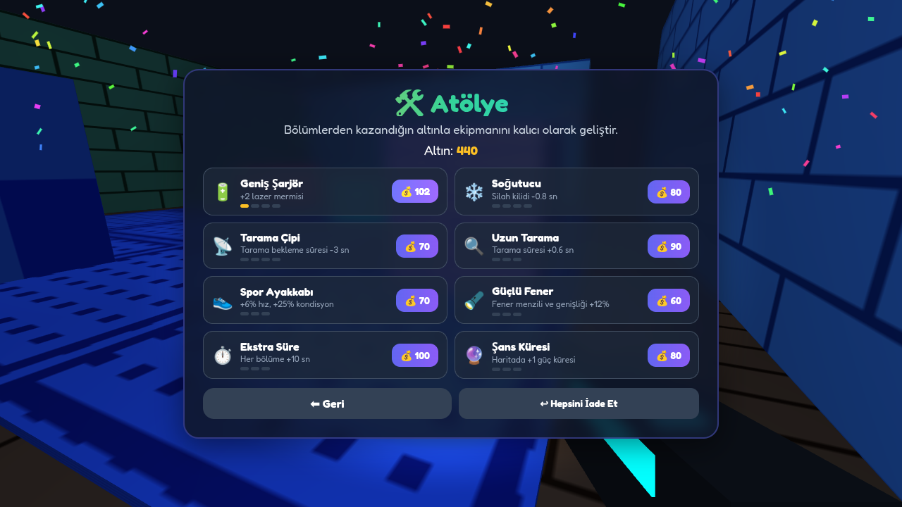
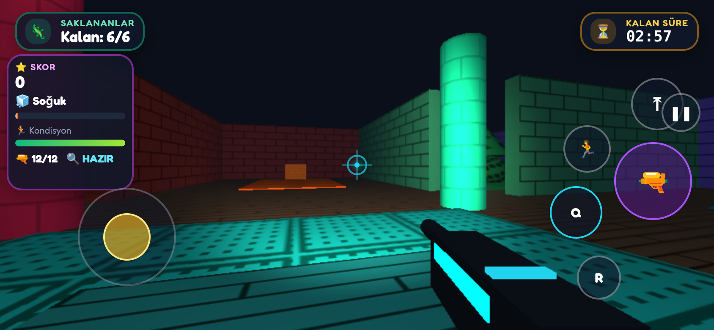

# 🦎 3D Bukalemun Saklambaç

Birinci şahıs 3D saklambaç oyunu: sen **arayan**sın, yapay zekâ bukalemunlar ise saklandıkları eşyanın rengine bürünüyor. Fenerini tut, gözünü dört aç, renk tonundaki küçük farkı yakala ve lazerle vur. Ama dikkat: **boşa ateş edersen silahın kilitlenir!**

### ▶️ Hemen oyna: **https://process631.github.io/bukalemun-saklambac/**

Kurulum gerekmez. Tek bir `index.html` dosyası, internet olmadan da çalışır (Three.js içine gömülü).

## 📸 Ekran görüntüleri

| Kamuflaj | Renk Taraması (Q) |
|---|---|
|  |  |
| **Yakaladın!** | **Sera Bahçesi** |
|  |  |
| **Oyuncak Fabrikası** | **Radar + Dondurucu** |
|  |  |
| **Bölüm sonu** | **Atölye** |
|  |  |

Mobil (dokunmatik joystick):

## 🎮 Kontroller

| Bilgisayar | Mobil | Ne yapar |
|---|---|---|
| `W A S D` / ok tuşları | Sol joystick (ekranın sol yarısı) | Hareket |
| Fare | Ekranın sağ yarısında sürükle | Etrafa bakış |
| `Shift` | 🏃 butonu (aç/kapa) | Koşma (kondisyon harcar) |
| `Boşluk` | ⤒ butonu | Zıplama (alçak eşyaların üstüne çıkabilirsin) |
| Sol tık / `F` | 🔫 butonu | Lazer |
| `Q` / sağ tık | `Q` butonu | Renk taraması |
| `R` | `R` butonu | Şarjörü doldur |
| `Esc` / `P` | ❚❚ butonu | Duraklat |
| Hazırlıkta `Boşluk` | Ekrana dokun | Hazırlık süresini hızlandır |

Fare kilitlenemiyorsa (ör. bir iframe içinde) basılı tutup sürükleyerek de bakabilirsin.

## ✨ Özellikler

- **Akıllı kamuflaj:** Bukalemunlar etraflarına ışın atıp en yakın duvarın, halının, çalının ya da kutunun rengini okuyor ve yumuşak bir geçişle o renge bürünüyor. Kamuflajda her zaman hafif bir ton farkı kalıyor. Nefes alıyor, ara sıra göz kırpıyorlar.
- **3 harita, 9 bölüm:** Renkli Malikane (orijinal harita), Sera Bahçesi (çit labirenti, çiçek tarhları, gölet, çardak) ve Oyuncak Fabrikası (neon ışıklar, blok kalesi, konveyörler). Bölümler ilerledikçe bukalemun sayısı 6'dan 12'ye çıkıyor.
- **3 bukalemun türü:** 🟠 Sıradan (100 puan), 🔵 **Kaçak**: yaklaşınca ya da fenerle üstüne tutunca hızla kaçar (150 puan), 🟣 **Usta**: şapkalı, kamuflajı neredeyse kusursuz (200 puan).
- **Daha akıllı yapay zekâ:** Izgara tabanlı A* yol bulmayla bukalemunlar duvarlara takılmıyor. Fenerin üstlerinde kalırsa ya da yanlarına ıska geçersen panikleyip senden uzak bir yere kaçabiliyorlar. Kaçarken kamuflajları bozuluyor, işte o an fırsat!
- **Yönlü kıkırdamalar:** Kıkırdamalar stereo çalıyor ("Solundan bir kıkırdama geldi!"). Bir de 🔥 sıcak/soğuk göstergesi var.
- **Güç küreleri:** ⚡ Süper hız · ⏱ +12 sn · 🔓 Silah ve tarama yenileme · 📡 Radar (ekranda yön okları) · ❄️ Dondurucu (bukalemunlar kaçamaz) · ✖2 Çift puan.
- **İlerleme:** Kombo puanları, bölüm başına 3 yıldız (kazan · sürenin %40'ı kalsın · %70 isabet), altın ve **Atölye**: Geniş Şarjör, Soğutucu, Tarama Çipi, Uzun Tarama, Spor Ayakkabı, Güçlü Fener, Ekstra Süre, Şans Küresi. Hepsi tarayıcıda (localStorage) kaydediliyor.
- **Daha akıcı oynanış:** Yumuşatılmış fare bakışı, ivmeli hareket, kafa sallanması, koşarken FOV artışı, zıplama ve iniş sarsıntısı, silah sallanması, geri tepme, doldurma animasyonu, isabet işareti, ekran sarsıntısı, uçan puan yazıları, konfeti.
- **Ses:** Web Audio ile üretilmiş efektler ve gerilim anında hızlanan müzik. Hiçbir ses dosyası yok.
- **Ayarlar:** Fare hassasiyeti, FOV, ses ve müzik seviyesi, Y eksenini ters çevirme, grafik kalitesi (gölgeler, çözünürlük).

## 🛠️ Orijinal prototipe göre düzeltmeler

- Fare kilitlenemediğinde etrafa bakılamıyordu. Artık sürükleyerek bakış var ve kilit isteği hata vermiyor.
- Her lazerde ve her parçacıkta yeni geometri/malzeme oluşturulup hiç silinmiyordu (bellek sızıntısı). Artık paylaşılan geometri, tek bir `InstancedMesh` parçacık sistemi ve düzgün `dispose` kullanılıyor.
- Saklananlar duvarlara takılıp sürekli yeni hedef seçiyordu. Bunun yerine A* yol bulma eklendi.
- Tailwind CDN uyarısı ve çevrimiçi bağımlılıklar kaldırıldı. CSS ve Three.js gömülü, oyun çevrimdışı çalışıyor.
- Silah modeli duvarların içine giriyordu. Artık ayrı bir katmanda çiziliyor.
- Dokular her nesne için yeniden üretiliyordu. Artık önbellekten geliyor. Çözünürlük oranı sınırlandı (mobilde daha hızlı).
- Ok tuşları ve boşluk sayfayı kaydırıyordu. Sekme değişince oyun duraklıyor.

## ⚠️ Bilinen sınırlamalar

- Grafikler low-poly ve prosedürel. Çok eski telefonlarda "Düşük" kalite ayarı önerilir.
- Bukalemunlar zıplayamaz, hep zeminde saklanırlar. Çarpışma kutuları silindir ve küreler için yaklaşık hesaplanıyor.
- iOS Safari'de fare kilidi yok, bu yüzden dokunmatik kontroller kullanılıyor.

## 📦 Teknik

- Tek dosya: `index.html` (≈730 KB, Three.js r128 dahil, MIT lisanslı)
- Üçüncü taraf API ya da sunucu yok. Kayıtlar yalnızca tarayıcının `localStorage`'ında tutuluyor.
